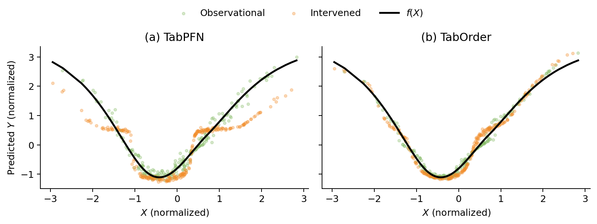

# TabOrder

TabOrder learns causal variable orderings and uses them to guide attention for
in-context tabular prediction and missing-value imputation. It learns from a
likelihood objective without ground-truth causal orders.

Official implementation of **[Learning Causal Orderings for In-Context Tabular Prediction](https://eda.rg.cispa.io/pubs/2026/taborder-xu,mameche,vreeken.pdf)**

Sascha Xu, Sarah Mameche, and Jilles Vreeken · **NeurIPS 2026**

[Paper](https://eda.rg.cispa.io/pubs/2026/taborder-xu,mameche,vreeken.pdf) ·
[Introductory notebook](examples/intro.ipynb) ·
[Pretrained weights](#pretrained-weights)



*Figure 1 from the paper, reconstructed from the saved predictions. The task is
to predict the mediator Y in X → Y → Z, before and after an intervention on the
mechanism generating Z. Green and orange points show observational and
intervened predictions; the black curve is the generating function.*

## Getting started

Requires Python 3.10 or newer. Clone the repository to obtain the code, notebooks,
and pretrained weights:

```sh
git clone https://github.com/Schascha1/TabOrder.git
cd TabOrder
python -m pip install -e '.[notebook]'
jupyter lab examples/intro.ipynb
```

The [introductory notebook](examples/intro.ipynb) runs on CPU and works offline by
default. It covers:

| Example | What you can run |
| --- | --- |
| Figure 1 | Recreate the paper's two-panel plot from the saved prediction data. |
| Synthetic order recovery | Generate additive GP structural causal models and compare inferred orders with random orders at several missingness levels. |
| Imputation | Compare both checkpoints with mean and KNN imputation on synthetic data and an offline real table. |
| Intervention prediction | Infer an order from observational context and compare predictions before and after changing a downstream mechanism. |

To execute the notebook without opening Jupyter:

```sh
python examples/run_intro.py
```

Figures, per-seed metrics, run metadata, and an executed notebook are written to
`outputs/intro/`. The notebook distinguishes the saved paper predictions from
fresh experiments with the bundled weights. Fresh TabPFN inference is optional;
see the notebook for its additional dependencies and model access requirements.

For a minimal installation and a short synthetic-data example:

```sh
python -m pip install -e .
python examples/quickstart.py
```

The core package requires only PyTorch, NumPy, and NetworkX. To use a GPU, install
a CUDA-enabled PyTorch build and pass `--device cuda` to the quickstart.

## Pretrained weights

Both checkpoints are included in the repository and load through the same API:

| Checkpoint | Training | Parameters |
| --- | --- | --- |
| `checkpoints/taborder-gp-small.pth` | Additive GP SCMs with 5–10 variables, without causal-order supervision | 2,899,473 |
| `checkpoints/taborder-cc18-ctr23.pth` | Joint fine-tuning on CC18 and CTR23 | 2,767,888 |

```python
from taborder import load_model

model = load_model("checkpoints/taborder-gp-small.pth", device="cpu")
# For the fine-tuned model:
model = load_model("checkpoints/taborder-cc18-ctr23.pth", device="cpu")
```

The loader selects the matching architecture, restores evaluation settings, and
loads every parameter strictly. Both models use six order blocks, four prediction
blocks, and 128-dimensional embeddings. Checkpoint hashes and provenance are
recorded in
[`checkpoints/manifest.json`](checkpoints/manifest.json).

## Impute your own table

Use `impute_table` for continuous-valued tables. Supply a NumPy array with context
rows first and query rows afterwards; mark missing entries with `NaN`.

```python
import numpy as np
from taborder import impute_table, load_model

model = load_model("checkpoints/taborder-cc18-ctr23.pth")

# values: a (rows, columns) NumPy array containing your table.
# n_context: the number of reference rows at the start of the table.
result = impute_table(
    model,
    values,
    missing=np.isnan(values),
    context_size=n_context,
)
filled_values = result["imputed"]
order = result["order_scores"].argsort()  # earlier variables first
```

The helper fits normalization on observed context entries and returns imputed
values in the original units, preserving observed entries. Each column requires
at least one observed context value. The notebook also shows how to infer an
order from observational context and hold it fixed for intervention prediction.

## Generate data and train

`SyntheticDataset` generates random DAGs and nonlinear structural mechanisms,
including additive and non-additive Gaussian processes approximated with random
Fourier features. See the notebook and
[`examples/quickstart.py`](examples/quickstart.py) for the input and mask format.

Train an additive GP model with:

```sh
python -m taborder.train --output runs/gp-small.pth
```

The default recipe uses 5–10 variables, 512–1024 rows, 20% MCAR masking, Gaussian
negative log-likelihood, and 25,000 updates. For a short CPU training run:

```sh
python -m taborder.train --steps 2 --batch-size 1 \
  --min-seq-len 32 --max-seq-len 32 --device cpu --output runs/smoke.pth
python examples/quickstart.py --checkpoint runs/smoke.pth
```

The compact trainer saves weights and configuration for inference. It starts a
new run and does not support resuming. For checkpoint provenance and the scope
of the included experiments, see the [release notes](RELEASE_NOTES.md).

## Development

```sh
python -m unittest discover -s tests -v
```

CI runs the tests and executes the introductory notebook, making its figures
and metrics available as a workflow artifact.

## Citation

If you use TabOrder in your research, please cite our paper:

Sascha Xu, Sarah Mameche, and Jilles Vreeken.
[Learning Causal Orderings for In-Context Tabular Prediction](https://eda.rg.cispa.io/pubs/2026/taborder-xu,mameche,vreeken.pdf).
NeurIPS, 2026.

```bibtex
@inproceedings{xu2026taborder,
  title     = {Learning Causal Orderings for In-Context Tabular Prediction},
  author    = {Xu, Sascha and Mameche, Sarah and Vreeken, Jilles},
  booktitle = {Advances in Neural Information Processing Systems},
  year      = {2026},
  url       = {https://eda.rg.cispa.io/pubs/2026/taborder-xu,mameche,vreeken.pdf}
}
```
